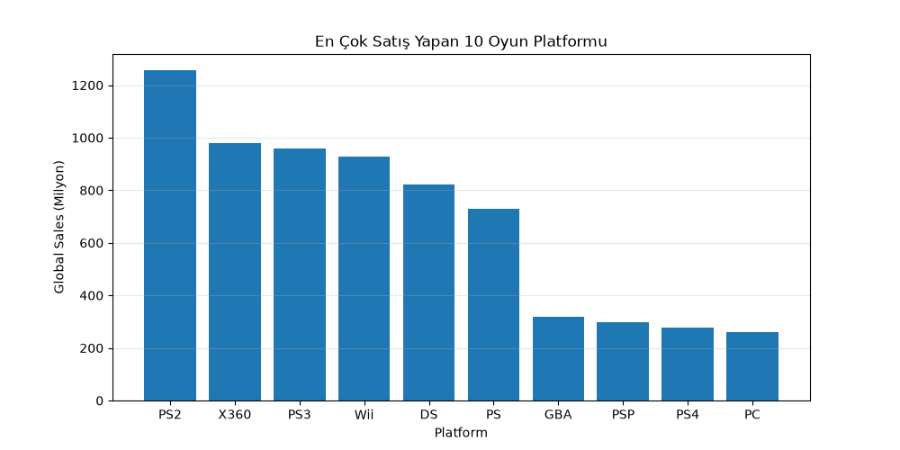
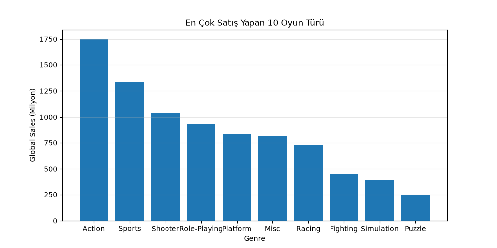
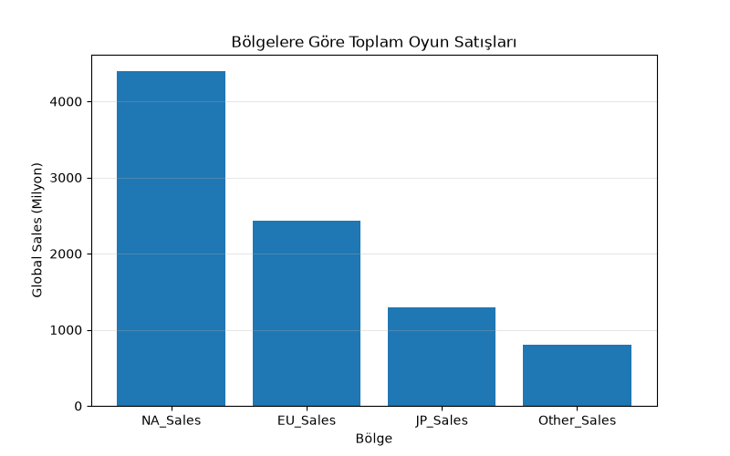

# video-oyun-satis-analizi
Python, Pandas ve Matplotlib kullanılarak video oyunlarının satış verilerinin analiz edildiği ve görselleştirildiği veri analizi projesi.

Kullanılan Teknolojiler
* Python
*Pandas
*Matplotlib
*Jupyter Notebook

Veri Seti
Video Game Sales veri seti kullanılmıştır.
Toplam kayıt: 16.598 oyun
Toplam sütun: 11
Eksik yıl bilgisi: 271
Eksik yayıncı bilgisi: 58

Yapılan Analizler
1.En çok satan 10 oyun
2.Platformlara göre toplam satışlar
3.Oyun türlerine göre toplam satışlar
4.Yayıncılara göre toplam satışlar
5.Yıllara göre toplam satışlar
6.Bölgelere göre toplam satışlar

 Önemli Bulgular

| Kategori          | Sonuç |   | Toplam Satış (Milyon) |

| En çok satan oyun | Wii Sports | 82.74 |
| En yüksek satışlı platform | PS2 | 1255.64 |
| En çok satan oyun türü | Action | 1751.18 |
| En yüksek satışlı yayıncı | Nintendo | 1786.56 |
| En yüksek satış yılı | 2008 | 678.90 |
| En yüksek satış bölgesi | Kuzey Amerika | 4392.95 |

 📊 Grafikler ve Görselleştirmeler

### Platformlara Göre Satışlar

### Oyun Türlerine Göre Satışlar

### Bölgelere Göre Satışlar

## 📌 Genel Değerlendirme

Bu projede video oyunlarının satış verileri Python kullanılarak analiz edilmiştir. Yapılan analizler sonucunda Wii Sports en çok satan oyun, PS2 en yüksek toplam satışa sahip platform ve Action en çok satış yapan oyun türü olarak belirlenmiştir.

Nintendo yayıncısı satışlarda öne çıkarken, 2008 yılı en yüksek satışın gerçekleştiği yıl olmuştur. Bölgesel satışlarda ise Kuzey Amerika ilk sırada yer almıştır.

Proje sürecinde Pandas ile veri analizi, gruplandırma ve sıralama; Matplotlib ile veri görselleştirme çalışmaları gerçekleştirilmiştir.
